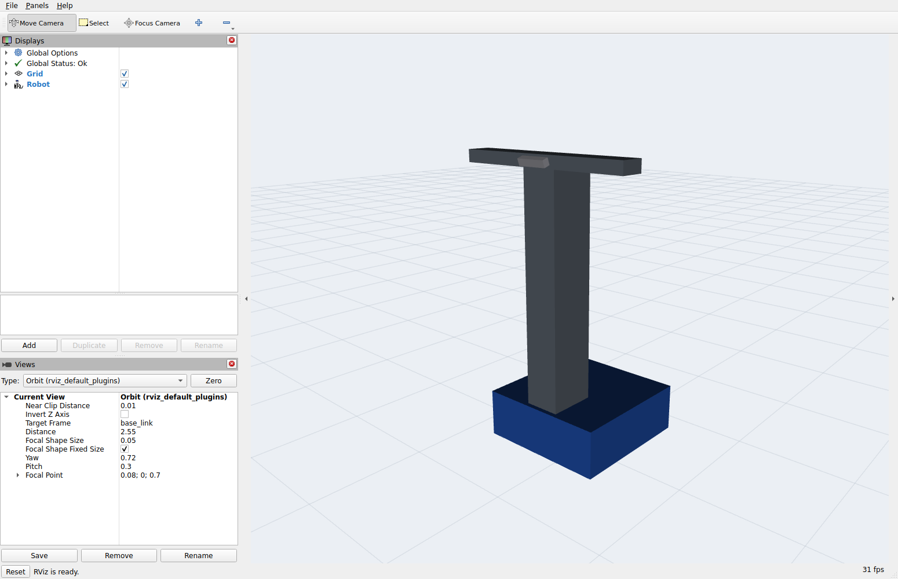
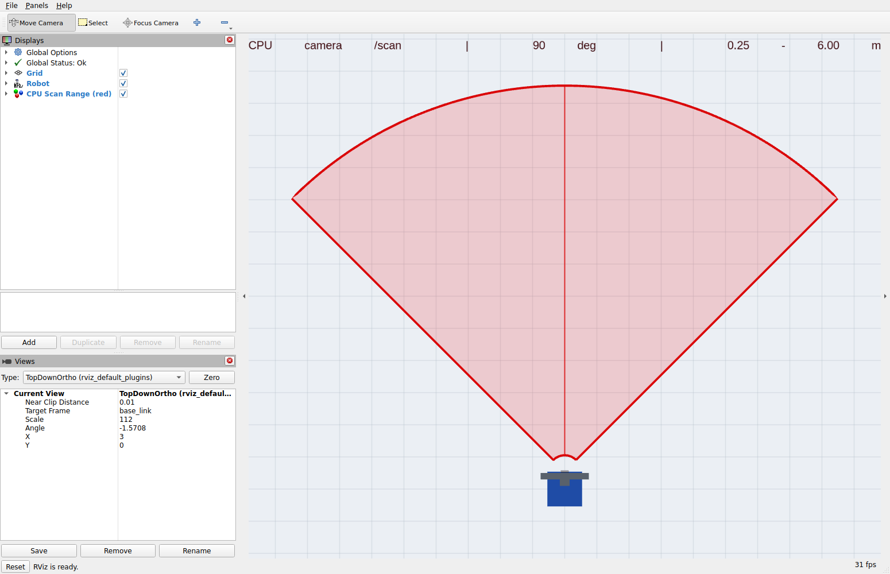

# Updated robot and CPU camera scan views

These are actual RViz screenshots captured on 2026-11-09 while running
`flow_base_sim.launch.py sensor:=camera camera_backend:=cpu camera_fps:=10
use_imu:=true gui:=true` in an isolated ROS domain and Gazebo partition.
The capture stopped only the processes it started. Existing navigation
configuration and robot source files were not changed for these screenshots.

## Updated robot

The current URDF has a 0.54 m square base, a transverse 0.75 m rail along Y
with 0.10 m depth and 0.05 m height, and a 0.20 x 0.15 m upright. The rail
front is 2 cm behind the base front, and its center is 1.25 m above the floor.
The Gemini 335L is mounted nominally in front of the rail. This RViz view
shows URDF visuals; the approximate simulation wheels are defined separately
in Gazebo's SDF and therefore are not visible in the URDF view.

## Red CPU scan range overlay

The screenshot uses the live CPU-derived `/scan` metadata: approximately
90 degrees angular width and a planar range of 0.25–6.0 m in
`camera_scan_frame`. The outer curved edge is 6 m from that frame's origin;
the small inner arc is the 0.25 m minimum. Robot +X points upward in this view.

The red sector is a temporary `visualization_msgs/MarkerArray` display on
`/screenshot/scan_range`, added for the requested field-of-view screenshot.
The existing CPU setup has scan points but no built-in solid range triangle.
The overlay represents configured scan limits, not actual obstacle returns,
guaranteed clear space, or the full pitched 3D optical frustum. CPU mode still
uses physics rays and `camera_to_scan`; it does not produce rendered camera
images or CameraInfo. `camera_to_scan` was the sole `/scan` publisher.

The RViz settings are saved in [robot_closeup.rviz](robot_closeup.rviz) and
[cpu_scan_range.rviz](cpu_scan_range.rviz). The second view additionally needs
the temporary marker publisher; opening the config alone will not recreate
the red sector. [capture_summary.json](capture_summary.json) records the live
scan limits and capture metadata. Stable image filenames above are the final
artifacts; window-ID filenames are intermediate captures and can be reused
by the window system between views.

## Window interaction observation

The current WSLg log reported `use_gfxredir = 1` and did not contain the
shared-memory allocation failure seen in the older COPY MODE incident.
Fresh RViz windows rendered both requested views. These captures do not
establish a fix for the user's mouse/fullscreen problem, whose cause was
not confirmed. WSL was not restarted.
