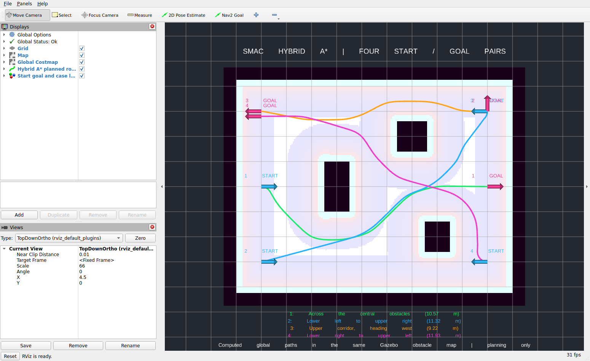

# FLOW Navigation

ROS 2 Jazzy navigation for the I2RT LinearBot FLOW holonomic base, developed in
Gazebo Harmonic with RViz. The current simulation combines **Smac Hybrid A***
global planning, **MPPI Omni** local control, a CPU approximation of a RealSense
D435i depth camera, and wheel/IMU state estimation.

**Current status:** controlled planning and obstacle-avoidance demonstrations
have passed. Physical geometry calibration, complete hardware bringup, SLAM
integration and YAM-arm integration remain future work. Long-maze planning and
full real-time simulation are not established.

## Run the simulation

The development environment is Ubuntu 24.04 / WSL2, ROS 2 Jazzy, Gazebo Harmonic
and Python 3.12. Install ROS/Gazebo and the colcon/rosdep tools before using the
commands below. These instructions run on the development PC, not the robot.

For a new checkout:

```bash
git clone https://github.com/UWMad-LabAutomation/flow-navigation.git ~/robot_ws
cd ~/robot_ws
source /opt/ros/jazzy/setup.bash
rosdep update
rosdep install --from-paths src --ignore-src -r -y --rosdistro jazzy
colcon build --symlink-install
source install/setup.bash
```

If you already have this checkout, start at `cd ~/robot_ws`. Initialize rosdep
once with `sudo rosdep init` if it has not been configured on the machine.
`requirements.txt` is a snapshot of the development Python environment;
installing it with pip does not install ROS, Gazebo or their system dependencies.
The default CPU camera plugin is built by colcon. The workspace's `colcon.meta`
builds the cloud-to-scan converter in Release mode.

Launch a random maze with both interfaces visible:

```bash
ros2 launch robot_navigation maze_navigation_launch.py \
  sensor:=camera camera_backend:=cpu camera_fps:=10 \
  use_imu:=true gui:=true use_rviz:=true
```

The launch prints the generated map/world paths, seed and spawn position.
In RViz, use **2D Pose Estimate** at the reported spawn, matching its heading,
then use **Nav2 Goal**. The standard maze spawn is `(-22.5, 22.5)` with yaw zero
(facing map +X). Start with a nearby goal in the open corridor. IMU fusion does
not remove AMCL's initial-pose requirement.

Add `seed:=42` to reproduce a maze. Stop the previous launch with **Ctrl+C**
before launching another in the same ROS domain. Keep `gui:=true` for world
inspection and obstacle insertion. GPU-capable WSL launches select Mesa D3D12
for the visible interfaces unless an explicit graphics override is supplied.
Navigation, the EKF and CPU camera ray casting remain CPU-based; the physical
robot does not need Gazebo rendering.

## Launch entry points

| Package / launch file | Purpose |
| --- | --- |
| `robot_navigation maze_navigation_launch.py` | Generated maze, matching map, Gazebo, CPU camera/scan pipeline, IMU/EKF, AMCL, Nav2 and RViz. Normal interactive simulation. |
| `robot_navigation navigation_launch.py` | Same navigation stack with a supplied matching `world:=...` and `map:=...`. |
| `robot_simulation flow_base_sim.launch.py` | Gazebo base, sensors, bridges and state estimation without Nav2. |
| `robot_state_estimation state_estimation.launch.py` | Standalone wheel/gyro EKF; no Gazebo or camera/base drivers. Defaults to real time. |

For a supplied environment, use absolute paths to a matching world and map:

```bash
ros2 launch robot_navigation navigation_launch.py \
  world:=/absolute/path/to/world.sdf map:=/absolute/path/to/map.yaml \
  sensor:=camera camera_backend:=cpu camera_fps:=10 \
  use_imu:=true gui:=true use_rviz:=true
```

Both navigation launch files include Gazebo. `use_sim_time:=false` alone does
not turn them into physical-robot bringup. There is no complete hardware launch
or `robot_base_bridge` source package in this checkout; `robot_bringup` is a
scaffold.

## How navigation is connected

```text
Gazebo collision geometry -> CPU camera rays -> /camera/depth/points
  -> camera_to_scan -> /scan -> AMCL and Nav2 obstacle layers

Wheel velocities + camera gyro -> EKF -> /odom and odom -> base_footprint
Saved/generated map + /scan -> AMCL -> map -> odom
Robot description -> robot_state_publisher -> fixed robot/sensor transforms

Smac Hybrid A* -> global path -> MPPI Omni -> velocity smoother
  -> total translation speed limiter -> collision monitor -> /cmd_vel
  -> Gazebo FLOW base
```

The EKF estimates short-term movement. AMCL locates that estimate in the map.
The D435i gyro has no absolute map position or yaw reference, so it does not
replace AMCL. Only gyro measurements are fused from the IMU; orientation and
linear acceleration are excluded. Each TF relationship has one owner.

Upcoming SLAM integration will need to supply `/map` and `map -> odom`, with
AMCL disabled in that mode. The EKF will retain `odom -> base_footprint`.
Receiving an occupancy map alone does not establish map localization.

### Planner and controller

The [Nav2 configuration](src/robot_navigation/config/nav2_flow_params.yaml)
uses:

- **Smac Hybrid A*** with forward Dubins motion, 72 heading bins, a 0.4 m
  minimum path radius and the rectangular robot footprint. Hybrid A* plans
  heading-aware curved routes; pure sideways global paths are not configured.
- **MPPI Omni** with 1,000 candidate trajectories and 48 steps of 0.05 s,
  giving a 2.4 s prediction horizon. Forward and sideways translation limits
  are 0.63 m/s, reverse is limited to 0.10 m/s, and yaw to 0.8 rad/s.
- A final **0.63 m/s combined translation limit**, including diagonals.
  Obstacles, acceleration limits and goal approach can require slower travel.
- A [forward-travel critic](src/robot_mppi_critics/README.md) that favors facing
  the route on clear paths while permitting lateral avoidance/corrections.
  Recovery trees use clearing, waiting and slow backup without Spin recovery.

### D435i camera approximation

The intended sensor is one forward-facing overhead D435i. Camera mode uses
only camera-derived `/scan`; no LiDAR runs in the default configuration.

| Setting | Default |
| --- | --- |
| Depth field of view | 87 degrees horizontal / 58 degrees vertical |
| Optical depth limits | 0.3-3.0 m |
| Mount reference | `(0, 0, 2.0)` m, centered on X; 2 m represents the fully raised elevator |
| Pitch | Automatic downward pitch, about 26.48 degrees at 2 m, targeting ground 1 m beyond the front edge |
| CPU sampling | 80 x 45 rays; independent of depth image resolution |
| Requested camera rate | 30 Hz simulation time by default; the interactive command above requests 10 Hz |
| Physical/rendered image profile | 1280 x 720 at a requested 30 FPS |

CPU rays query current collision geometry, including inserted/moving objects,
and publish synthetic PointCloud2. CPU mode creates no rendered depth sensor,
depth images or CameraInfo. It approximates geometric coverage/occlusion;
sparse rays and ideal surfaces do not reproduce all stereo noise, holes,
lighting effects or thin-object detections.

The converter transforms points into a level scan frame at Z=0.22 m and keeps
points 0.10-1.00 m above the ground. Missing returns remain unknown. One forward
camera leaves side/rear blind spots during holonomic motion.

`camera_z`, camera pose/FOV/range and ray density are adjustable. The simulation
holds the selected elevator height with a fixed joint; elevator motion and
actuated camera tilt are not modeled. The optional `camera_backend:=render`
uses the separate [local projection correction](src/robot_simulation/README.md#local-projection-correction).
It is unnecessary for CPU sensing or physical RealSense data. `sensor:=lidar`
is retained only as a legacy simulation option.

## Completed demonstrations

The figures below are recorded simulation evidence, not claims about hardware
or the current live session.

| Demonstration | Result | Evidence |
| --- | --- | --- |
| Hybrid A* start/goal cases | Four planned paths passed interpolated footprint checks in a custom Gazebo obstacle map. Screenshots are actual RViz captures; the robot was not driven from each virtual start. | [Cases and screenshots](Progress_Reports/path_planning_evidence_2026-11-01/README.md) |
| Visible holonomic navigation | Three planning queries and three navigation goals passed with an inserted obstacle. Peak command speed 0.63 m/s, peak lateral command 0.1059 m/s, measured lateral travel 0.488 m. Sole `/scan` publisher: `camera_to_scan`. | [Summary](Progress_Reports/holonomic_navigation_2026-11-01/validation_summary.json), [motion plot](Progress_Reports/holonomic_navigation_2026-11-01/paths_and_navigation.png) |
| IMU/EKF simulation accuracy | Timestamp-matched 24.035 s physics check: maximum EKF position error 9.03 mm and heading error 0.116 degrees. Configured simulation noise, not hardware calibration. | [Accuracy data](Progress_Reports/forward_navigation_2026-10-28/imu_accuracy_summary.json) |
| Visible maze performance | Equivalent wall merging reduced 242 boxes to 126 for one seed; short-window real-time factor improved from about 0.34 to 0.60. | [Measurements](Progress_Reports/gui_rendering_2026-10-28/maze_performance.json) |



Reproduce the controlled navigation course from a sourced workspace, using a
new output directory and an unused ROS domain:

```bash
python3 src/robot_navigation/scripts/validate_holonomic_navigation.py \
  --output /tmp/flow_navigation_check_new --domain 93 --dynamic-obstacle
```

This checker opens Gazebo and RViz, runs its isolated test and shuts down its
own launch after recording results. The relocated screenshot helper in
`Progress_Reports` contains original session paths/PIDs; use its saved evidence
as the record rather than treating it as the normal navigation launcher.

### Open limitations

- **Long-maze search:** the current 1,000,000-iteration / 5 s Hybrid A* budget
  has been exhausted on long winding mazes. A visually nearby goal may require
  a large detour. Small-room success does not establish arbitrary-maze success.
- **Localization and timing:** AMCL still needs an initial pose; map alignment,
  scan freshness and TF timestamps require checking. Startup/reset TF warnings
  are separate from a global planner exhausting its search budget.
- **Throughput:** requested sensor rates and robot speeds use simulation time.
  Visible maze runs on the development PC can be slower than real time.
- **Model fidelity:** chassis height/mass/COM/inertias, caster behavior and
  mounting details need physical measurement. The Gazebo MecanumDrive model
  is an approximation of a powered-caster base.

## Next steps

The next two modeling tasks begin **after the actual robot has been measured
and observed**. Preserve unknown values as provisional until then.

1. **Update the robot URDF to match physical hardware**
   Measure chassis dimensions, wheel/caster geometry, sensor mounts and
   collision clearances. Update the URDF and reconcile the separate Gazebo SDF,
   including justified mass/inertia values. Deliver the updated URDF and an
   RViz visualization.
2. **Validate the updated model and physics in Gazebo**
   Compare forward/lateral movement, turning and obstacle clearance with
   observed hardware behavior. Adjust Nav2 footprint and motion limits as
   needed. Deliver a short visible Gazebo demonstration.
3. **Integrate SLAM soon.** Connect the selected mapping/localization pipeline,
   establish `/map` and TF ownership, provide a SLAM launch mode, and validate
   map alignment and navigation/replanning. This can progress alongside
   hardware measurements; no SLAM implementation is marked complete here.
4. **Complete physical bringup and calibration.** Connect real D435i
   PointCloud2/IMU data, measured sensor/elevator transforms, wheel odometry
   and the FLOW CAN bridge. Validate the real robot before treating simulation
   tuning as hardware calibration. The target sensing contract remains
   D435i -> RealSense ROS driver -> PointCloud2 -> camera_to_scan -> `/scan` -> Nav2.
5. **Include the rail and YAM arms later.** Add measured geometry, joints,
   collisions and configuration-dependent sensor transforms. Account for the
   arm/rail envelope and mass distribution, then implement navigation and
   manipulation handoff. Navigation controls base vx/vy/yaw; manipulation/VLA
   controls the rail and arms.

The deployment target is Jetson Thor. Keep navigation CPU-oriented so GPU
resources remain available for vision/manipulation and the chosen SLAM system.

## Repository guide

| Location | Contents |
| --- | --- |
| [robot_description](src/robot_description/README.md) | Simplified FLOW Xacro, camera and robot frames |
| [robot_simulation](src/robot_simulation/README.md) | Gazebo world, mazes, sensor configuration, bridges, WSL graphics selection and checks |
| [robot_cpu_camera](src/robot_cpu_camera/README.md) | C++ physics-ray camera plugin |
| [robot_navigation](src/robot_navigation/README.md) | Nav2 parameters, behavior trees, velocity limiter and navigation checker |
| [robot_mppi_critics](src/robot_mppi_critics/README.md) | Forward-travel preference for MPPI |
| [robot_state_estimation](src/robot_state_estimation/README.md) | Wheel/gyro EKF configuration, launch and accuracy checks |
| [third_party](src/third_party/README.md) | Vendored pointcloud_to_laserscan 2.0.2 |
| [Progress_Reports](Progress_Reports/robot_navigation_progress_report.txt) | Progress notes, measurements, plots and screenshots |
| [AGENTS.md](AGENTS.md) | Project context, change policy, current status and implementation guidance |

Project packages declare Apache-2.0. The vendored pointcloud_to_laserscan
package retains its upstream BSD license and notices; see its
[LICENSE](src/third_party/pointcloud_to_laserscan/LICENSE).